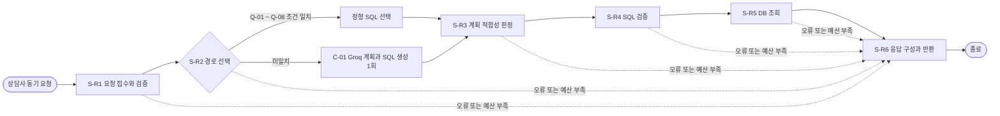

# SQL 검색기 과제 설계 확정본

작성일: 2026-10-21  
팀명: law-consult  
작업 방식: AI 팀원 역할별 독립 검토 후 클로니 통합. 사람 팀원의 실제 회의로 기록하지 않음  
범위: 워크플로우 설계, 새 논리 뷰, 정형쿼리 Q-08, DB 재적재와 SQL 실행 검증

## 1. 상담 상황과 데이터 근거

상담사가 연회비 부담 고객에게 보유 카드별 상품 자료의 연회비와 최근 승인 사용액을 함께 보여 주는 상황 가정.  
실습 DB에는 법령과 판례 테이블이 없으므로 팀의 법률 보고서 목표 대신 카드 고객 상담 데이터를 설계 대상으로 삼음.  
예시 질문: “보유 중인 카드별 자료상 연회비와 최근 6개월 승인 사용액을 알려줘.”  
DB의 `member.segment_id=6`은 연회비 부담 고객군임. 예시 회원 `M-6074`는 활성 카드 2장 보유.  
`M-6074`의 상담 내용은 저장소에 없으므로 질문과 상담 상황은 가상 사례임.  
기준일 `2026-08-31`의 최근 6개 달은 `2026-03-01` ~ `2026-08-31`임.

| 카드 | 자료상 총연회비 | 6개월 승인 사용액 | 승인 건수 | 상품 자료 시행일 |  
| --- | ---: | ---: | ---: | --- |  
| CARD_001 | 32,000원 | 273,405원 | 40건 | 2027-01-15 |  
| CARD_002 | 52,000원 | 262,573원 | 38건 | 2027-01-15 |

위 수치는 교육용 합성 DB에서 조회한 결과임. 상품 시행일이 기준일보다 늦으므로 연회비는 실제 청구액이 아님.  
승인 사용액은 혜택 실적 또는 청구금액이 아니며, 이 두 수치만으로 해지나 절약액을 판단하지 않음.  
근거: `rdb/init/01_schema.sql`, `rdb/init/02_seed.sql`, `rdb/README.md`, `db_validation.json`.  
상품 원천으로 기록된 D2 PDF는 저장소에서 찾지 못해 원문 대조는 수행하지 못함.

## 2. 팀 역할, 논의와 최종 결정

| 역할 | 맡은 일 | 제안과 피드백 | 통합 결과 |  
| --- | --- | --- | --- |  
| 클로니 | 흐름 결정, SQL 구현, DB 검증, 최종 통합 | 단일 뷰 Q-08과 6단계 경로 유지 | 반영 |  
| 법원이 | DB 출처와 시점 점검 | 시행일, 거래 기준일, 승인 상태 근거 확인 | 반영 |  
| 리야 | 고객 오해와 데이터 경계 검토 | 미래 시행일 표시, 월중 제공 시작일 정확 처리 | 반영 |  
| 쉽게 | 단계, 반복, 커넥터, 예산과 쉬운 응답 검토 | Q-08 일치 조건과 응답의 의미 제한 | 반영 |

설계 결정: 6단계 순차 처리, S-R2에서 정형쿼리와 Groq 경로 중 하나 선택, 요청 내부 반복 0회.  
정형 경로에는 Q-08 추가. 새 뷰는 카드 1장당 1행, 정확한 날짜 구간의 승인 거래만 집계.  
`cardlab` 계정 사용은 사용자 지정 사항임. 관리 계정이므로 DB 계정의 최소 권한 보장은 주장하지 않음.  
실습 설계의 SQL 허용 목록과 AST 검증을 필수 경계로 둠. 일반 운영으로 전환할 때 제한 계정 사용 필요.  
독립 검토 기록: `scenario_review.md`, `workflow_review.md`, `source_review.md`.

## 3. 확정 워크플로우와 Mermaid

복사 가능한 원본: `workflow.mmd`.  
병렬 실행 없음. 앞 단계의 출력이 다음 단계의 입력임. 분기 이후 다시 합류하며 이전 단계로 되돌아가지 않음.

## 4. 단계별 설계

### S-R1 요청 접수와 검증

| 항목 | 확정 내용 |  
| --- | --- |  
| 입력 | `question:string`, `auth_scope:AuthScope`, `config:Config` |  
| 처리 | 단조 시계 시작, 회원 권한 확인, 질문의 식별자 제거, 기준일과 제공 시작일 확인 |  
| 출력 | `Context`에 정제 질문, 회원 범위, 날짜, 정책, `error=null` 적재 |  
| 담당 | 규칙 기반 코드 |  
| 오류 | 인증 실패, 범위 불명확, 비식별 실패 시 오류를 담아 S-R6 이동 |  
| 한계 | 원문 질문과 회원 ID를 Groq에 보내거나 일반 로그에 남기지 않음 |

### S-R2 정형쿼리 또는 NL2SQL 선택

| 항목 | 확정 내용 |  
| --- | --- |  
| 입력 | S-R1의 `Context`와 정제 질문 |  
| 처리 | 의도, 기간, 결과 단위, 요청 지표가 등록 조건과 모두 일치하면 Q-ID 선택 |  
| Q-08 조건 | 카드 단위, 기준월 포함 최근 6개 달, 자료상 연회비와 승인액/건수 질문 |  
| 다른 조건 | 실제 청구액, 혜택 손익, 해지 권고 또는 월별 추세 요청은 Q-08에 불일치 |  
| 대체 경로 | 고정 조건에 없으면 Groq C-01 한 번 호출. 지원 불가 항목은 S-R3에서 종료 |  
| 출력 | `Context.plan`에 `route`, `query_id`, `view`, `grain`, `sql`, 기간 기록 |  
| 담당/오류 | 규칙 코드와 Groq. 시간 초과 또는 잘못된 JSON은 S-R6 이동 |

### S-R3 계획 적합성 판정

| 항목 | 확정 내용 |  
| --- | --- |  
| 입력 | S-R2의 `Context.plan` |  
| 처리 | 질문 조건과 계획의 의도, 날짜, 카드 단위, 공개 뷰와 지표 일치 확인 |  
| Q-08 검사 | `app.card_fee_usage_6m` 1개 뷰, 활성 카드, 표시 가능 지표만 허용 |  
| 출력 | `Context.plan_check=true` 또는 오류 |  
| 담당/오류 | 규칙 코드. 실제 청구액 또는 혜택 손익 요구는 `UNSUPPORTED`로 S-R6 이동 |

### S-R4 SQL 검증

| 항목 | 확정 내용 |  
| --- | --- |  
| 입력 | 계획에 포함된 정형 SQL 또는 모델 생성 SQL |  
| 처리 | SQL 구문 트리로 단일 SELECT, 단일 허용 `app` 뷰, 허용 컬럼과 LIMIT 검사 |  
| 제한 | 원본 테이블, `app_internal`, 데이터 변경, 다중 문장, 세션 조작, 200행 초과 금지 |  
| 출력 | `validated_sql`, `sql_fingerprint` 또는 `SQL_REJECTED` |  
| 담당/오류 | 규칙 코드. 정형 SQL도 같은 검사 적용. 실패 시 재생성 없이 S-R6 이동 |  
| 계정 주의 | `cardlab`은 원본 권한이 있으므로 검증기 우회 가능성이 권한으로 차단되지는 않음 |

### S-R5 SQL 실행

| 항목 | 확정 내용 |  
| --- | --- |  
| 입력 | `validated_sql`, 요청 회원 ID, 기준일, 제공 시작일, 남은 시간 |  
| 처리 | `cardlab` 연결, 읽기 전용 트랜잭션, 3개 세션 변수의 트랜잭션 범위 설정 후 SQL 실행 |  
| 출력 | 최대 200행의 `QueryResult` 또는 오류. 부분 행은 반환하지 않음 |  
| 담당 | 규칙 기반 DB 코드. DB는 시스템 내부 구성요소 |  
| 오류 | 대기 또는 실행 시간 초과 시 취소와 롤백, 불완전 연결 폐기 후 S-R6 이동 |

### S-R6 응답 구성과 반환

| 항목 | 확정 내용 |  
| --- | --- |  
| 입력 | 결과 또는 오류가 포함된 `Context` |  
| 처리 | 금액 단위, 승인 사용액 기간, 상품 시행일, 데이터 한계와 오류 코드 구성 |  
| Q-08 응답 | `listed_annual_fee`는 자료상 안내값, `approved_amount_6m`는 승인 거래 합계로 설명 |  
| 출력 | 상담사에게 `Response`와 HTTP 상태 반환. 원본 회원 ID와 카드 ID 제외 |  
| 담당/오류 | 규칙 코드. 직렬화 실패 시 최소 오류 응답, 전송 실패 시 연결 종료 기록 |  
| 시간 | 예약한 1초로 종료 처리. 1.5초의 새 단계 시작 기준은 적용하지 않음 |

## 5. 반복 구간과 워크플로우 명세

| 항목 | 확정 내용 |  
| --- | --- |  
| 반복 구간 | 없음. S-R2의 정형/Groq 선택은 분기이며 반복이 아님 |  
| Groq, SQL 재시도 | 요청 안에서 각각 0회. SDK 자동 재시도도 0회 설정 |  
| 반복 최악값 | 0초 |  
| 실패 착지 | S-R1 ~ S-R5 어느 단계에서든 S-R6 |  
| 호출자 재요청 | 독립적인 새 요청으로 처음부터 처리 |

| 항목 | W-1 SQL 검색기 |  
| --- | --- |  
| 트리거 | 상담사의 동기 검색 요청 1건 |  
| 목적 | 요청 회원의 허용된 카드 정보만 조회하여 범위와 한계를 반환 |  
| 성공 | 검증된 조회 완료 후 S-R6 응답 |  
| 실패 | 입력, 계획, SQL, 외부 연동, DB 또는 시간 오류를 표준 코드로 반환 |  
| 상태 저장/재개 | 요청 중간 상태의 영속화 없음. 재개 없음 |  
| 시간 예산 | 전체 30초. 외부 호출 최악값 15초, 내부와 종료 몫 15초 |

## 6. C-01 Groq 커넥터

| 항목 | 확정 내용 |  
| --- | --- |  
| 목적 | 정형쿼리와 일치하지 않는 질문의 단일 뷰 조회 계획과 SQL 생성 |  
| 제공자/모델 | Groq / `openai/gpt-oss-120b` |  
| API | `POST https://api.groq.com/openai/v1/chat/completions` |  
| 인증 | 서버 환경변수 `GROQ_API_KEY`의 Bearer 토큰 |  
| SDK | `AsyncGroq`, `timeout=15`, `max_retries=0` |  
| 생성 설정 | `temperature=0.1`, `max_completion_tokens=2048`, `stream=false` |  
| 응답 제약 | `json_schema.strict=true`, JSON 상태 `ready/unsupported/ambiguous` |  
| 허용 입력 | 정제 질문, 확정 슬롯, 기준일, 제공 시작일, 공개 뷰 8개의 스키마와 SQL 정책 |  
| 전송 금지 | 원문 질문, 회원 ID, 원본 카드 ID, 인증정보, DB 결과, 내부 뷰 |  
| 후속 검사 | 반환 JSON 스키마 검사, S-R3 계획 검사, S-R4 SQL 구문 트리 검사 |  
| 오류 | 15초 초과 `UPSTREAM_TIMEOUT`, 429와 제공자 오류 `UPSTREAM_UNAVAILABLE` |

새 뷰를 공개 카탈로그, 시스템 프롬프트와 SQL 허용 목록에 **같은 버전으로** 반영해야 함.  
과제 산출물로 `public_view_catalog.json`, `fixed_query_catalog.json`, `C-01_prompt.md`,  
`C-01_response_schema.json`을 작성함. 실행 서비스 코드가 없어 런타임 등록은 미구현임.  
Groq의 실제 계정 가용성, 설정 조합과 응답 시간은 API 실호출을 하지 않아 검증되지 않음.  
공식 근거: [Chat Completions](https://console.groq.com/docs/api-reference),  
[구조화 출력](https://console.groq.com/docs/structured-outputs),  
[공식 Python SDK](https://github.com/groq/groq-python).

## 7. 남은 시간 예산 정책

| 기준 | 값 | 이유 |  
| --- | ---: | --- |  
| 전체 요청 상한 | 30초 | 기존 설계의 동기 응답 목표 유지 |  
| 종료 처리 예약 | 1초 | 성공 또는 최소 오류 응답 반환 |  
| 새 단계 시작 기준 | 1.5초 | 전체의 5%로 시작 여부 판단 |  
| Groq 호출 상한 | 15초 | 한 번의 외부 호출 대기 최악값 |  
| 내부 처리 몫 | 최대 14초 | `30 - 15 - 1` |  
| 반복 시간 | 0초 | 재시도 0회 |

`시작 가능 시간 = 30 - 실제 경과초 - 종료 예약 1초 - 미실행 Groq 예약 15초 또는 0초`.  
각 S-R1 ~ S-R5 직전에 시작 가능 시간이 `1.5초 이상`인지 단조 시계로 검사함.  
예: S-R2 Groq 경로 앞에서 2초 경과 시 `30 - 2 - 1 - 15 = 12초`이므로 시작 가능.  
S-R5 앞에서 28초 경과 시 `30 - 28 - 1 = 1초`이므로 S-R6으로 이동.  
DB 풀 대기, 연결, 쿼리와 결과 수신을 시작 후 29초인 내부 중단시각에 맞춤.  
`statement_timeout`은 매 쿼리 직전 남은 내부 시간 이하로 설정함.  
위 수치는 정책값이며 30초 이내 실제 응답 달성의 측정값은 아님.

## 8. 논리 뷰와 정형쿼리

새 뷰 `app.card_fee_usage_6m`은 카드 한 장당 한 행을 반환함.  
기준월 포함 최근 6개 달의 시작일, `app.coverage_start`, 카드 발급일 중 가장 늦은 날부터 기준일까지 집계.  
`APPROVED` 거래만 사용하고 `CANCELLED`는 제외함. 제공 시작일이 월중이어도 이전 거래는 제외함.  
관측 기간이 있으나 거래가 없으면 0원과 0건. 관측 기간이 없으면 기간과 사용 지표를 `NULL`로 반환.  
카드 표시에는 `card_ref`만 사용하고 원본 `card_id`는 공개하지 않음.  
뷰 소유자는 `app_reader`, 옵션은 `security_barrier=true`; 기존 회원 RLS를 활용함.  
뷰 정의: `crc/rdb/init/07_card_fee_usage.sql`.

Q-08은 활성 카드만 조회하고 `listed_annual_fee` 내림차순, 승인 사용액 오름차순으로 정렬함.  
이 순서는 화면 표시 순서이며 해지 권고 순위가 아님. `LIMIT 20`으로 최대 200행 정책을 충족함.  
쿼리 정의: `Q-08.sql`. 실행 전 동일 트랜잭션에서 `app.member_id`, `app.base_date`,  
`app.coverage_start`를 설정해야 함.

## 9. 적용 및 검증 결과

`crc/rdb`에서 `docker compose down -v` 후 `docker compose up -d`로 볼륨을 삭제하고 재적재함.  
컨테이너의 healthy 상태, `07_card_fee_usage.sql` 초기화 로그, Q-08 결과 2행을 확인함.  
`cardlab`과 `sql_retriever_user`에서 Q-08 결과가 일치함. 세션 범위가 없을 때 새 뷰는 0행임.  
월중 제공 시작일 `2026-08-15`의 결과가 원본 승인 거래 독립 집계와 일치함.  
제공 시작일이 기준일 이후면 관측 지표가 `NULL`임. 회원을 바꾸면 조회 결과도 달라짐.  
`sql_retriever_user`의 새 뷰 SELECT 권한, 원본 거래와 private 스키마 무권한을 확인함.  
증거: `db_reset_receipt.json`, `db_init_log_excerpt.txt`, `db_validation.json`, 재실행 도구 `validate_db.py`.

SQL 조회와 권한 검증은 완료. Groq 실제 호출, 서비스 전체 30초 성능, 사람이 실제 PowerPoint에서 연 결과는 미검증.

## 10. 과제 항목과 새 발표자료 페이지

| 과제 항목 | 과제완성본 페이지 |  
| --- | --- |  
| 상황과 팀 논의, 워크플로우 및 Mermaid | 1 ~ 4 |  
| 단계별 설계 S-R1 ~ S-R6 | 5 ~ 10 |  
| 반복 구간과 워크플로우 명세 | 11 ~ 12 |  
| Groq 커넥터 | 13 ~ 15 |  
| 남은 시간 예산 정책 | 16 ~ 17 |  
| 새 논리 뷰와 정형쿼리 Q-08 | 18 ~ 19 |  
| DB 조회 증거와 검증 한계 | 20 ~ 21 |
