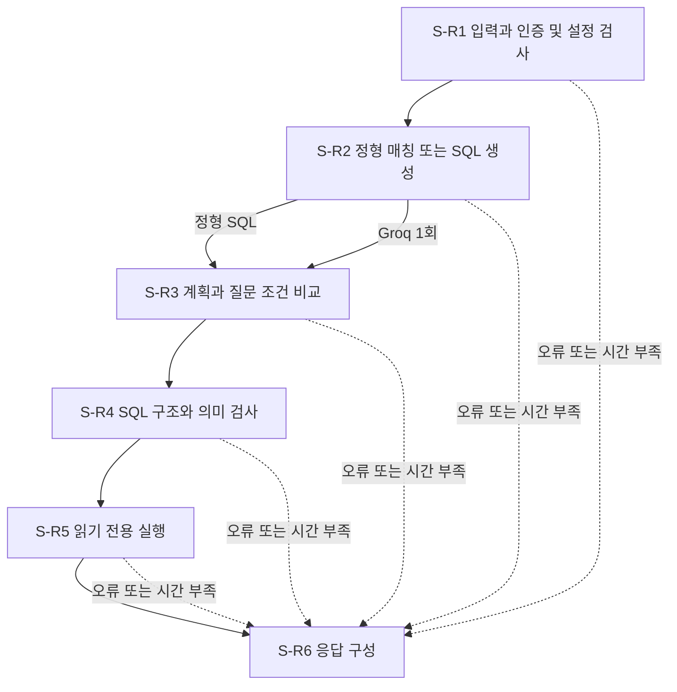

# SQL 검색기

상담사 질문을 승인된 8개 논리뷰에서 읽기 전용으로 조회하는 Python 3.12 프로그램임.  
정형쿼리는 미리 확정한 SQL이며, NL2SQL은 자연어 질문을 모델이 SQL로 바꾸는 방식임.  
행 수준 보안(RLS)은 로그인한 회원 범위의 행만 보이도록 제한하는 DB 정책임.

구현과 외부 연동 없는 시험은 제공됨. 실제 DB 및 Groq를 함께 사용하는 통합시험은 설정 준비 후 필요함.  
현재 검증 범위와 실행 근거는 `work/test_report.md` 참조.

## 주요 기능

- 등록 질문 8개는 모델 호출 없이 실행, 그 외 지원 질문은 Groq 최대 1회 호출
- 질문의 개인정보 정제, 인증 토큰과 회원 범위의 서버 측 매핑
- SQL 구조, 허용 뷰와 컬럼, 질문의 지표와 기간, 필터 검증
- 관리자와 원본 테이블 조회 권한 차단, 읽기 전용 트랜잭션과 회원 세션 격리
- 질문 4KiB, SQL 16KiB, 결과 200행 및 1MiB 제한
- 전체 업무 시간 30초, 재시도 없음, 동일 응답 형식의 CLI와 HTTP API

## 흐름



## 구조와 설계 대조

| 위치 | 책임 |
|---|---|
| `domain/` | 개인정보, 질문 해석, 계획 검증, 시간 계산 |
| `application/ports.py` | 모델과 DB 및 검증기 계약 |
| `application/services.py` | S-R1부터 S-R6까지 업무와 오류 응답 |
| `infrastructure/workflow.py` | LangChain 순서 실행, 자동 추적 비활성화 |
| `infrastructure/sql_validator.py` | SQLGlot을 통한 SQL 검사 |
| `infrastructure/groq_gateway.py` | 승인 모델 설정, JSON 검증, 단일 호출 |
| `infrastructure/postgres.py` | 독립 연결, 권한 확인, 세션 변수, 결과 제한 |
| `infrastructure/settings.py` | 설정 읽기와 토큰 검증 |
| `presentation/` | CLI와 API 입출력 |
| `bootstrap.py` | 실제 구현체 생성 및 주입 |
| `resources/` | 승인 프롬프트 전문, 정형 SQL, 스키마, 오류와 정책 |
| `tests/` | 외부 연동 없는 회귀 시험 |
| `work/` | 설계 대조, 개발 계획, 시험 근거 |

상세 근거 파일과 시험 연결은 `work/design_trace.md` 참조.

## 설치

저장소 루트에서 `crc/sql-retriever`로 이동 후 실행함. Python 3.12 설치 필요.  
프로젝트 안 `.venv`만 사용하며 시스템 패키지를 공유하지 않음.

macOS zsh 또는 bash:

```bash
cd crc/sql-retriever
python3.12 -m venv .venv
source .venv/bin/activate
python -m pip install -r requirements.txt
```

Windows PowerShell:

```powershell
cd crc/sql-retriever
py -3.12 -m venv .venv
.\.venv\Scripts\Activate.ps1
python -m pip install -r requirements.txt
```

Windows Git Bash:

```bash
cd crc/sql-retriever
py -3.12 -m venv .venv
source .venv/Scripts/activate
python -m pip install -r requirements.txt
```

PowerShell 정책상 활성화가 제한되면 `.\.venv\Scripts\python.exe`로 직접 실행 가능함.

## 사용자 설정

`runtime.example.json`을 `runtime.local.json`으로 복사한 뒤 사용자가 값을 채움.  
로컬 설정과 비밀 환경파일은 Git 제외 대상임.

| 설정 | 필요한 내용 |
|---|---|
| `metadata.base_date` | 데이터의 실제 기준일, ISO 날짜 |
| `metadata.coverage_start` | 데이터의 실제 제공 시작일, ISO 날짜 |
| `metadata.loaded_at` | 해당 기준값 확인 시각, 시간대가 있는 ISO 시각 |
| `auth[].principal_id` | 로컬 인증 주체의 식별값 |
| `auth[].authorized_member_id` | 그 인증 주체가 조회 가능한 실제 시험 회원 |
| `auth[].token_env` | 해당 주체의 비밀 토큰을 담은 환경파일 키 이름 |

`loaded_at`은 기준정보 확인 시각이며 거래 발생일과 다름. 24시간 경과 시 재확인 후 갱신 필요함.  
회원 2개의 인증 범위를 등록하면 회원별 실행 통합시험 수행 가능함.

`crc/secrets/.env`의 아래 항목을 사용자가 직접 입력함. 프로그램은 읽기만 수행함.

| 환경변수 | 설명 |
|---|---|
| `RDB_HOST` | PostgreSQL 호스트 |
| `RDB_PORT` | PostgreSQL 포트 |
| `RDB_DATABASE` | DB 이름 |
| `RDB_USER` | 승인 뷰만 조회 가능한 비관리자 실행 계정 |
| `RDB_PASSWORD` | 해당 실행 계정 비밀번호 |
| `GROQ_API_KEY` | Groq API 키 |
| `SQL_RETRIEVER_TOKEN_A` | 첫 번째 인증 주체의 무작위 토큰, 최소 32자 |
| `SQL_RETRIEVER_TOKEN_B` | 두 번째 인증 주체의 별도 무작위 토큰, 최소 32자 |

`cardlab`과 `postgres`는 접속 전 차단됨. 그 외 계정도 접속 후 관리자 역할과 원본 테이블 권한 검사함.  
DB 계정 생성이나 권한 변경은 이 프로그램에서 수행하지 않음.

모델은 승인된 `openai/gpt-oss-120b`, 호출 제한은 15초, 재시도는 0회임.  
서버와 CLI는 기본적으로 `.env`에서만 서버 비밀값을 읽음. 셸 변수의 자동 덮어쓰기는 사용하지 않음.

## 실행

CLI는 셸의 `SQL_RETRIEVER_CLIENT_TOKEN`에 서버에 등록한 토큰을 설정한 뒤 실행함.  
비밀 토큰을 명령 인자로 넘기지 않음. 질문도 표준 입력으로 전달하면 셸 이력 노출을 줄일 수 있음.

```bash
python run_cli.py '가입일과 연령대'
python run_cli.py '보유 카드 수'
python run_cli.py --config runtime.local.json --env ../secrets/.env
```

마지막 명령은 표준 입력에서 질문을 받음. 정상 종료 코드는 0, 업무 오류는 1임.  
`--token-env`로 클라이언트 토큰을 읽을 셸 환경변수 이름 변경 가능함.

API 서버:

```bash
python -m uvicorn serve_api:app --host 127.0.0.1 --port 8000 --no-access-log
```

macOS와 Git Bash의 요청 예:

```bash
curl --silent http://127.0.0.1:8000/search \
  -H "Authorization: Bearer ${SQL_RETRIEVER_CLIENT_TOKEN}" \
  -H 'Content-Type: application/json' \
  --data '{"question":"가입일과 연령대"}'
```

PowerShell의 요청 예:

```powershell
$headers = @{Authorization = "Bearer $env:SQL_RETRIEVER_CLIENT_TOKEN"}
$body = @{question = '가입일과 연령대'} | ConvertTo-Json
Invoke-RestMethod -Uri http://127.0.0.1:8000/search -Method Post `
  -Headers $headers -ContentType 'application/json; charset=utf-8' -Body $body
```

본문에는 `question`만 허용됨. 회원 ID나 인증 범위를 본문에 넣으면 거부됨.  
업무 오류도 `request_id`, `status`, `data`, `error`, `meta` 필드로 반환됨.  
API 본문 수신은 최대 5초이며 업무의 30초 예산은 본문 수신 후부터 적용됨.

## 등록된 질문

| 조회 | 질문 |
|---|---|
| Q-01 | 가입일과 연령대 |
| Q-02 | 전체 보유 카드와 상품 안내 연회비 |
| Q-03 | 최근 6개월 카드별 월별 승인 사용액과 거래 건수 |
| Q-04 | 최신 완료월 연체 현황 |
| Q-05 | 최근 6개월 카드별 월별 가맹점별 승인 사용액과 거래 건수 |
| Q-06 | 최근 12개 완료월 연체 이력 |
| Q-07 | 최근 90일 일별 승인 사용액과 거래 건수 |
| Q-08 | 활성 카드별 최근 6개월 자료상 연회비와 승인 사용액 및 거래 건수 |

추가 조건이 붙으면 그대로 정형쿼리로 처리하지 않음. 해석 가능한 질문은 NL2SQL로 전달함.  
모호하거나 지원하지 않는 질문은 오류로 반환하며 모델이 임의로 의미를 채우지 않음.

## 시험

```bash
python -m pytest -q
python -m mypy domain application infrastructure presentation bootstrap.py run_integration.py
python run_integration.py
```

첫 시험은 DB와 모델을 가짜 구현으로 교체하므로 외부 호출이 없음.  
`run_integration.py`는 실제 Groq와 DB를 사용하며 필수 설정이 없으면 접속 없이 종료 코드 2를 반환함.  
성공 시 0, 실행 중 시험 실패 시 1을 반환함. 업무 데이터 행은 보고서에 저장하지 않음.  
카탈로그 차이가 있으면 이후 질문 시험을 중지함.

## 지원 범위와 제한

- 자유로운 모든 한국어 질문을 처리하는 제품은 아님. 등록 동의어와 명시적 지표 및 기간 중심 구현임
- SQL은 승인 뷰 한 개만 사용. JOIN, 하위 쿼리, CTE, UNION, 윈도 함수와 임의 함수는 거부됨
- `pg_catalog`로 한정한 함수 표기도 보수적으로 거부함. 허용 함수는 미한정 이름만 사용함
- DB 연결은 요청마다 생성하고 폐기함. 최대 8개 연결이며 재사용 풀은 사용하지 않음
- 결과 한도와 별개로 DB 드라이버는 단일 행을 디코딩할 메모리가 필요함
- 행 상한에 닿으면 추가 행 여부를 모르는 상태로 표시함. 결과 없음은 거래 없음의 증명이 아님
- 큰 정수와 numeric 값은 정밀도 보존을 위해 문자열로 반환 가능함. NULL과 0은 구분함
- 상품 안내 연회비를 실제 청구액으로 해석하거나 카드 해지 권고에 사용하지 않음
- 로컬 토큰 인증은 교육용 배치임. 외부 공개 서비스의 인증 운영을 대체하지 않음
- 두 회원 호출 성공만으로 DB의 실제 행 격리가 증명되지는 않음. 정답 데이터 대조가 별도로 필요함
